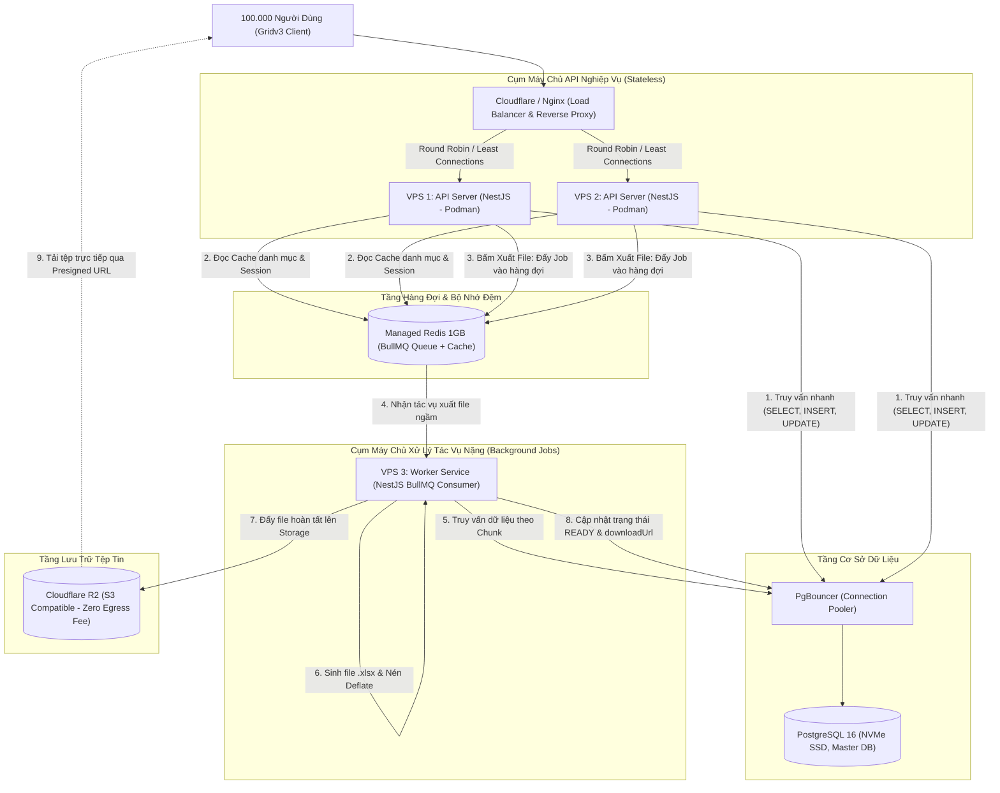
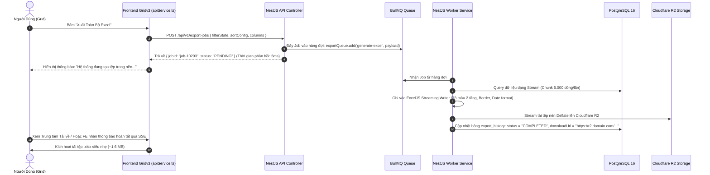
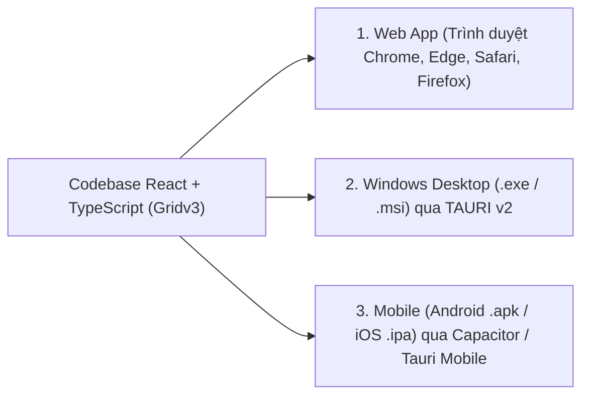
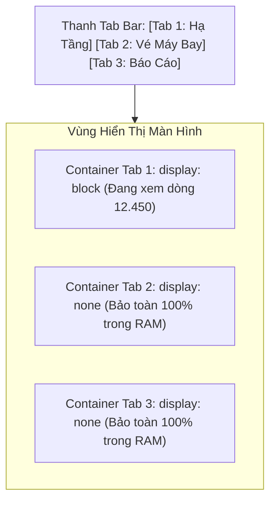
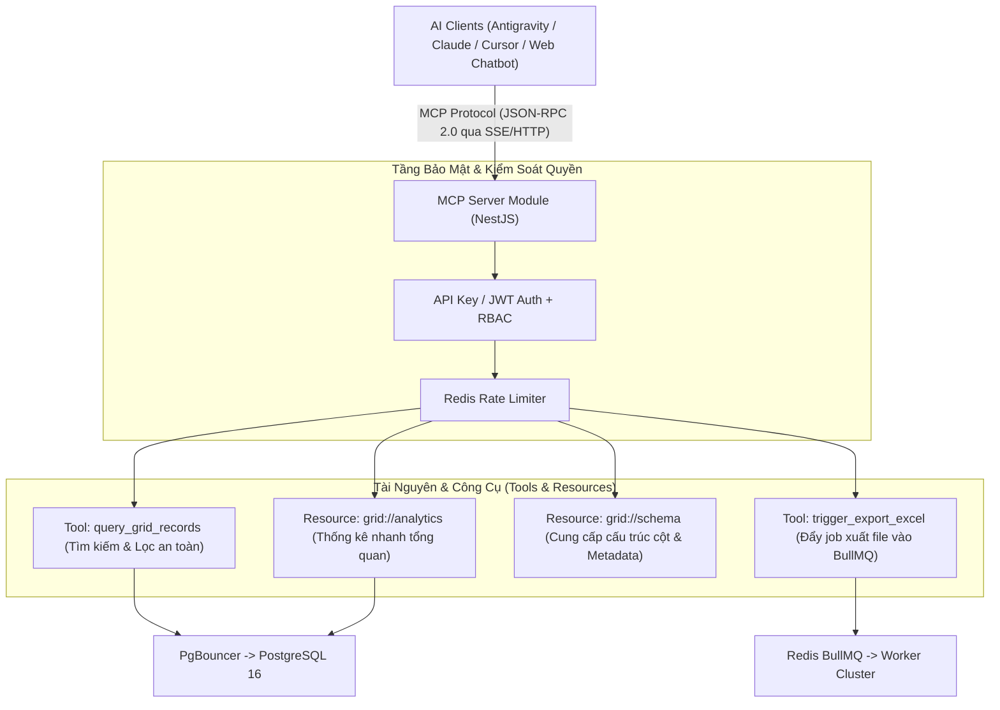

# Tài Liệu Thiết Kế Kiến Trúc Backend Cho Hệ Thống 100.000 Người Dùng

> **Phiên bản**: 1.0.0  
> **Dự án**: Gridv3 Data-Driven High-Performance Virtualized Grid  
> **Ngày phê duyệt**: 2026-10-26  
> **Mục tiêu**: Đảm bảo hệ thống vận hành mượt mà cho 100.000 người dùng, xử lý truy vấn dữ liệu lớn và xuất báo cáo Excel (50.000 – 100.000 dòng) không làm nghẽn luồng ứng dụng.

---

## 1. Sơ Đồ Kiến Trúc Tổng Thể (System Architecture)



---

## 2. Bảng Phân Bổ Phần Cứng & Vai Trò Máy Chủ

| Máy chủ / Dịch vụ | Cấu hình phần cứng | Công nghệ cốt lõi | Vai trò chuyên trách |
| :--- | :--- | :--- | :--- |
| **API Server 1** | 4 vCPU / 8 GB RAM | NestJS, Podman, Fastify | Tiếp nhận request người dùng, xác thực (JWT), phân trang Grid, CRUD nhanh. |
| **API Server 2** | 4 vCPU / 8 GB RAM | NestJS, Podman, Fastify | Cân bằng tải song song với API Server 1, đảm bảo tính sẵn sàng cao (High Availability). |
| **Worker Server** | 4 vCPU / 8 GB RAM | NestJS, BullMQ, ExcelJS (Streaming) | Chạy ngầm 100%, chuyên trách query dữ liệu lớn, tạo file Excel và upload R2. Không chạy API public. |
| **Database Server** | 8 vCPU / 16 GB RAM + NVMe SSD | PostgreSQL 16 + PgBouncer | Lưu trữ dữ liệu quan hệ, chỉ mục (B-Tree, GIN index), phân vùng bảng (Partitioning). |
| **Managed Redis** | 1 GB RAM chuyên dụng | Redis 7 | Quản lý hàng đợi BullMQ và bộ nhớ đệm (Cache) danh mục tĩnh. |
| **Cloud Storage** | Không giới hạn | Cloudflare R2 | Lưu file Excel xuất ra, miễn phí 100% băng thông tải về (Zero Egress Fee). |

---

## 3. Ba Nguyên Tắc Kỹ Thuật "Sống Còn"

### 3.1. Cân Bằng Tải (Load Balancing) Trước 2 VPS API
- Đặt **Cloudflare Load Balancing** hoặc Reverse Proxy **Nginx / HAProxy** đứng trước 2 máy chủ API.
- Thuật toán: `Least Connections` (ưu tiên chuyển request đến máy chủ đang có ít kết nối nhất).
- Tích hợp Health Check (`/api/health`): Nếu 1 VPS gặp sự cố bảo trì, hệ thống tự động dồn 100% traffic sang VPS còn lại trong 0 giây.

### 3.2. Bắt Buộc Cài Đặt `PgBouncer` Trước PostgreSQL
- **Lý do**: Cụm 2 API Server chạy container Podman + Worker có thể mở hàng trăm connection ảo cùng lúc. Nếu kết nối trực tiếp, PostgreSQL sẽ nhanh chóng cạn kiệt tài nguyên RAM và lỗi `too many connections`.
- **Cấu hình**:
  - Chế độ: `pool_mode = transaction`.
  - `default_pool_size = 30` (gom hàng nghìn connection từ NestJS thành 30–50 connection thực tế tới PostgreSQL).

### 3.3. Chiến Lược Quản Lý Bộ Nhớ Redis (Cache vs Queue)
- Gói Redis 1GB dùng chung cho 2 mục đích, cần quy định nghiêm ngặt:
  - **Key Cache**: Bắt buộc gắn thời gian hết hạn (`TTL: 300s - 3600s`).
  - **Key BullMQ**: Không bao giờ được phép mất dữ liệu. Trong cấu hình Redis, set policy an toàn cho Job Queue:
    ```ini
    maxmemory 900mb
    maxmemory-policy volatile-lru
    ```
  - Khi đầy bộ nhớ, Redis chỉ xóa các key có TTL (Cache), tuyệt đối không xóa key của BullMQ.

---

## 4. Luồng Xuất File Excel Bất Đồng Bộ (Async Export Workflow)



---

## 5. Mã Nguồn Mẫu Tích Hợp (Reference Implementation)

### 5.1. Phía Backend: Producer (NestJS Controller)
```typescript
// export.controller.ts
@Controller('api/v1/export-jobs')
export class ExportController {
  constructor(@InjectQueue('excel-export-queue') private exportQueue: Queue) {}

  @Post()
  async requestExport(@Body() dto: ExportRequestDto, @Req() req: any) {
    const job = await this.exportQueue.add('export-grid-data', {
      userId: req.user.id,
      filename: dto.filename || 'HaTang_DienToanDamMay',
      filterState: dto.filterState,
      sortConfig: dto.sortConfig,
      columns: dto.columns,
    }, {
      attempts: 3,
      removeOnComplete: true,
      removeOnFail: false,
    });

    return {
      success: true,
      jobId: job.id,
      message: 'Yêu cầu xuất file đã được tiếp nhận.',
    };
  }
}
```

### 5.2. Phía Backend: Consumer (NestJS Worker Service)
```typescript
// export.processor.ts
@Processor('excel-export-queue')
export class ExportProcessor {
  constructor(private readonly s3Service: CloudflareR2Service, private readonly db: DatabaseService) {}

  @Process('export-grid-data')
  async handleExport(job: Job<ExportJobData>) {
    const { filename, filterState, columns, userId } = job.data;
    
    // Sử dụng ExcelJS Streaming Writer để không bị tràn RAM
    const workbook = new ExcelJS.stream.xlsx.WorkbookWriter({
      useStyles: true,
      useSharedStrings: false,
    });
    const worksheet = workbook.addWorksheet('DuLieu');

    // Thiết lập Header 2 tầng, border, và tô màu tương phản
    this.setupHeaders(worksheet, columns);

    // Stream đọc DB theo chunk 5.000 dòng
    const cursor = this.db.streamRecords(filterState);
    for await (const row of cursor) {
      worksheet.addRow(this.formatRow(row, columns)).commit();
    }
    worksheet.commit();
    await workbook.commit();

    // Upload lên Cloudflare R2 và lấy URL tải về có chữ ký (Presigned URL)
    const downloadUrl = await this.s3Service.uploadStream(`${filename}_${Date.now()}.xlsx`, workbook.stream);
    await this.db.saveExportHistory(userId, downloadUrl);
  }
}
```

### 5.3. Phía Frontend: Kết Nối Trong [`src/services/apiService.ts`](file:///d:/Dự%20án/Gridv3/src/services/apiService.ts)
```typescript
// src/services/apiService.ts
export async function exportGridExcelApi(params: ExportExcelParams): Promise<boolean> {
  try {
    const res = await fetch('/api/v1/export-jobs', {
      method: 'POST',
      headers: { 'Content-Type': 'application/json' },
      body: JSON.stringify({
        filename: params.filename,
        filterState: params.filterState,
        sortConfig: params.sortConfig,
        columns: params.columns?.map(c => ({ key: c.key, title: c.title, dataType: c.dataType })),
      }),
    });
    const data = await res.json();
    return data.success;
  } catch (err) {
    console.error('Lỗi khi gửi yêu cầu xuất file:', err);
    return false;
  }
}
```

---

## 6. Chiến Lược Tối Ưu Chi Phí & Vận Hành Bền Vững

1. **Vòng đời tệp tin (R2 Lifecycle Policy)**: Thiết lập tự động xóa tệp sau 7 ngày để không tích tụ rác lưu trữ.
2. **Triển khai Podman**:
   - Sử dụng `podman-compose` hoặc tệp định nghĩa container tĩnh.
   - Không chạy dưới quyền `root` (Rootless mode) để triệt tiêu rủi ro an ninh mạng.
3. **Giám sát hệ thống (Monitoring)**:
   - Cài đặt Prometheus + Grafana trên VPS Worker để theo dõi CPU/RAM, độ dài hàng đợi BullMQ và độ trễ Database.

---

## 7. Kiến Trúc Frontend Đa Nền Tảng (Cross-Platform) & Ứng Dụng Windows Với TAURI v2

### 7.1. Chiến Lược 1 Codebase Ra 4 Nền Tảng (Web, Windows, Android, iOS)

Tận dụng 100% mã nguồn React + TypeScript + Tailwind hiện tại của Gridv3, không phải viết lại code cho từng nền tảng:



### 7.2. Vì Sao Chọn TAURI v2 Cho App Windows (Thay Vì Electron)?

| Tiêu chí | Electron (Cũ) | TAURI v2 (Khuyên Dùng) | Lợi ích cho Gridv3 |
| :--- | :--- | :--- | :--- |
| **Kích thước bộ cài** | 150 MB – 250 MB | **5 MB – 10 MB** | Tải về cài đặt trong vài giây |
| **Tiêu thụ RAM** | 300 MB – 600 MB | **30 MB – 60 MB** | Tiết kiệm tài nguyên máy tính tối đa |
| **Thời gian khởi động**| 2.5s – 4.0s | **< 0.4s** | Mở tức thì như ứng dụng native C++/C# |
| **Nền tảng hiển thị** | Tự đóng gói Chromium riêng | Sử dụng **WebView2** có sẵn của Windows | Luôn được Microsoft bảo mật và tối ưu GPU |
| **Tính năng Native** | Hạn chế | Đầy đủ: System Tray, Global Hotkeys, Custom Titlebar, Auto-update, File System |

### 7.3. Cơ Chế Multi-Tab Keep-Alive: Mở Nhiều Tab Tuyệt Đối Không Bị Load Lại

#### A. Vấn đề của cơ chế chuyển trang thông thường (Router Unmount)
Trong các ứng dụng web thông thường, khi chuyển trang (ví dụ từ Tab "Hạ Tầng" sang Tab "Chuyến Bay"), trang cũ bị **Unmount** (hủy khỏi bộ nhớ DOM). Khi bấm quay lại, toàn bộ component bị dựng lại từ đầu: gọi lại API, hiện màn hình chờ (loading), mất sạch vị trí cuộn chuột và điều kiện lọc.

#### B. Giải pháp: Keep-Alive Component Container (Off-Screen DOM Pattern)
Tương tự cơ chế của các phần mềm ERP / Kế toán chuyên nghiệp (SAP, MISA, VS Code):



1. **Không Unmount Component**:
   - Khi mở Tab mới: Dựng giao diện bảng cho Tab đó.
   - Khi chuyển tab: Tab cũ chỉ chuyển sang `display: none` (hoặc ẩn khỏi màn hình).
2. **Độ trễ chuyển tab bằng 0ms (Zero-Latency)**:
   - Khi người dùng click quay lại Tab cũ: Trình duyệt chuyển sang `display: block` ngay lập tức trong 0 mili-giây. Không gọi lại API, không có spinner chờ, thanh cuộn vẫn đứng im vị trí cũ, dữ liệu trong cell editor đang nhập dở vẫn giữ nguyên.
3. **Hiệu năng RAM được đảm bảo nhờ Chunk Virtualization (CHUNK = 20)**:
   - Dù mỗi Tab chứa 50.000 dòng dữ liệu, động cơ ảo hóa Gridv3 chỉ render đúng ~60-80 thẻ dòng HTML DOM (~200 node DOM).
   - Khi mở 20 Tabs đồng thời, tổng số thẻ DOM trên toàn ứng dụng vẫn dưới 4.000 thẻ, tiêu thụ RAM chỉ tăng thêm vài chục MB cho mảng plain JSON. Ứng dụng chạy mượt mà 60fps tuyệt đối.

---

## 8. Kiến Trúc Tích Hợp MCP (Model Context Protocol) Server Cho AI & Tự Động Hóa

### 8.1. Vai Trò Của MCP Trong Hệ Thống Gridv3

Model Context Protocol (MCP) là giao thức mở chuẩn hóa cho phép các trợ lý AI (như Antigravity, Claude, Cursor, Copilot hoặc AI Chatbot nội bộ) kết nối an toàn với cơ sở dữ liệu và các tác vụ nghiệp vụ của Backend Gridv3:
- **Hỏi đáp & phân tích dữ liệu tự nhiên**: "Tìm cho tôi các máy chủ có SLA dưới 98% tại khu vực Miền Bắc trong quý 3."
- **Tự động hóa tác vụ**: "Xuất báo cáo tài nguyên của tất cả node OVERLOAD ra file Excel và gửi link tải cho tôi."
- **Tự động cấu hình bộ lọc Grid**: AI tự sinh câu lệnh lọc CMD hoặc cây điều kiện lọc phức tạp và áp dụng trực tiếp lên bảng Gridv3 của người dùng.



### 8.2. Phương Thức Triển Khai (Transport & Vị Trí Hạ Tầng)

1. **Vị trí chạy**:
   - Tích hợp trực tiếp thành một Module chuyên trách trong cụm **NestJS API Server** (sử dụng thư viện chính thức `@modelcontextprotocol/sdk`).
   - Sử dụng chung kết nối Database qua **PgBouncer** và hàng đợi **BullMQ**.
2. **Giao thức truyền thông (Transport)**:
   - **SSE Transport (Server-Sent Events qua HTTPS)**: Dành cho môi trường Production (Client AI kết nối từ xa qua Internet). Endpoint: `/api/v1/mcp/sse`.
   - **Stdio Transport**: Dành cho môi trường phát triển cục bộ (Local Dev kết nối trực tiếp với Desktop App).

### 8.3. Danh Mục MCP Tools & Resources Cung Cấp

| Loại | Tên định danh | Tham số đầu vào | Mô tả chức năng |
| :--- | :--- | :--- | :--- |
| **Tool** | `query_grid_records` | `filters`, `sort`, `limit` (max 100), `offset` | Truy vấn dữ liệu an toàn với các toán tử lọc chuẩn của Gridv3 (equals, contains, between...). |
| **Tool** | `trigger_export_excel` | `filename`, `filters`, `columns` | Khởi tạo job xuất Excel 50k–100k dòng vào BullMQ và trả về `jobId` kèm link tải Cloudflare R2 khi hoàn tất. |
| **Tool** | `get_column_analytics` | `columnKey`, `metric` (sum, avg, min, max) | Tính toán nhanh các chỉ số tổng hợp trên cột mà không cần tải toàn bộ dòng về AI context. |
| **Resource** | `grid://schema` | Không có | Trả về JSON mô tả toàn bộ định nghĩa cột (`INITIAL_COLUMNS`), kiểu dữ liệu (`DATA_TYPES`) và nhóm Band (`BASE_GROUPS_DEF`). |
| **Resource** | `grid://system-health`| Không có | Trả về trạng thái cụm máy chủ, số lượng job đang chờ trong BullMQ và độ trễ truy vấn Database. |

### 8.4. Bảo Mật & Kiểm Soát Rủi Ro (Guardrails)

1. **Chặn SQL Injection 100%**:
   - AI Agent không được phép gửi câu lệnh SQL thô (`raw SQL`).
   - MCP Tool chỉ nhận JSON định dạng điều kiện lọc và chuyển đổi thành Parameterized Query qua Query Builder / ORM.
2. **Phân quyền chặt chẽ (RBAC)**:
   - Mặc định MCP Server cấp quyền **Read-Only** (chỉ tra cứu và xuất báo cáo).
   - Các hành động ghi/sửa dữ liệu bắt buộc phải có Token quyền Quản Trị và ghi nhật ký kiểm toán (Audit Log) đầy đủ.
3. **Giới hạn kích thước phản hồi (Context Window Protection)**:
   - Tool `query_grid_records` tự động giới hạn tối đa 50–100 dòng cho mỗi lần AI tra cứu để tránh làm tràn bộ nhớ token ngữ cảnh của mô hình LLM.

### 8.5. Mã Nguồn Mẫu Triển Khai NestJS MCP Module

```typescript
// mcp.service.ts
import { Injectable, OnModuleInit } from '@nestjs/common';
import { McpServer } from '@modelcontextprotocol/sdk/server/mcp.js';
import { SSEServerTransport } from '@modelcontextprotocol/sdk/server/sse.js';
import { z } from 'zod';
import { DatabaseService } from '../database/database.service';
import { Queue } from 'bullmq';
import { InjectQueue } from '@nestjs/bullmq';

@Injectable()
export class McpService implements OnModuleInit {
  private server: McpServer;

  constructor(
    private readonly db: DatabaseService,
    @InjectQueue('excel-export-queue') private readonly exportQueue: Queue,
  ) {
    this.server = new McpServer({
      name: 'gridv3-mcp-server',
      version: '1.0.0',
    });
  }

  onModuleInit() {
    // 1. Khai báo Resource: Schema cột dữ liệu của Grid
    this.server.resource('grid-schema', 'grid://schema', async () => ({
      contents: [{
        uri: 'grid://schema',
        mimeType: 'application/json',
        text: JSON.stringify(this.db.getColumnDefinitions(), null, 2),
      }],
    }));

    // 2. Khai báo Tool: Truy vấn bản ghi theo điều kiện lọc
    this.server.tool(
      'query_grid_records',
      {
        keyword: z.string().optional().describe('Từ khóa tìm kiếm nhanh'),
        status: z.enum(['ONLINE', 'DEGRADED', 'OVERLOAD']).optional().describe('Lọc theo trạng thái'),
        minSla: z.number().optional().describe('SLA tối thiểu (ví dụ 98.5)'),
        limit: z.number().default(20).describe('Số bản ghi cần lấy (tối đa 100)'),
      },
      async ({ keyword, status, minSla, limit }) => {
        const records = await this.db.queryRecords({ keyword, status, minSla, limit });
        return {
          content: [{ type: 'text', text: JSON.stringify(records, null, 2) }],
        };
      },
    );

    // 3. Khai báo Tool: Yêu cầu xuất báo cáo Excel ngầm
    this.server.tool(
      'trigger_export_excel',
      {
        filename: z.string().describe('Tên tệp Excel mong muốn'),
        statusFilter: z.string().optional().describe('Điều kiện lọc trạng thái nếu có'),
      },
      async ({ filename, statusFilter }) => {
        const job = await this.exportQueue.add('export-grid-data', {
          filename,
          filterState: { status: statusFilter },
        });
        return {
          content: [{
            type: 'text',
            text: `Đã tiếp nhận yêu cầu xuất báo cáo. Mã tác vụ: ${job.id}. File sẽ được lưu vào Cloudflare R2 sau khi hoàn tất.`,
          }],
        };
      },
    );
  }

  // Kết nối HTTP SSE Transport cho Controller gọi vào
  createSseTransport(res: any) {
    return new SSEServerTransport('/api/v1/mcp/messages', res);
  }
}
```

