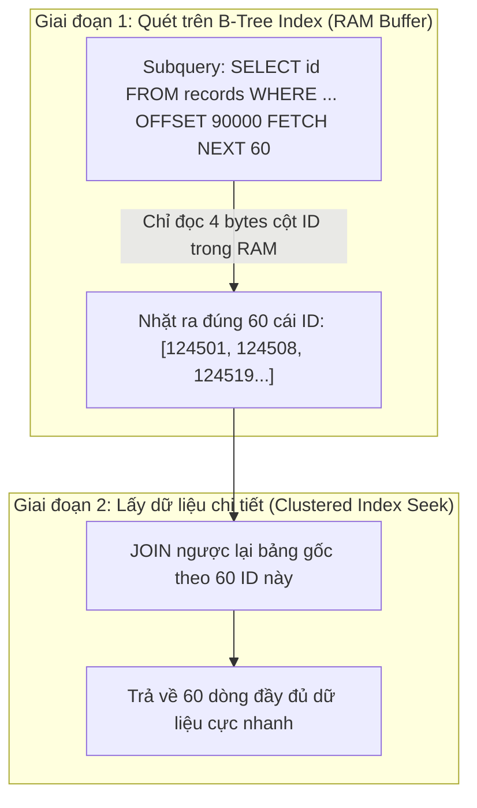
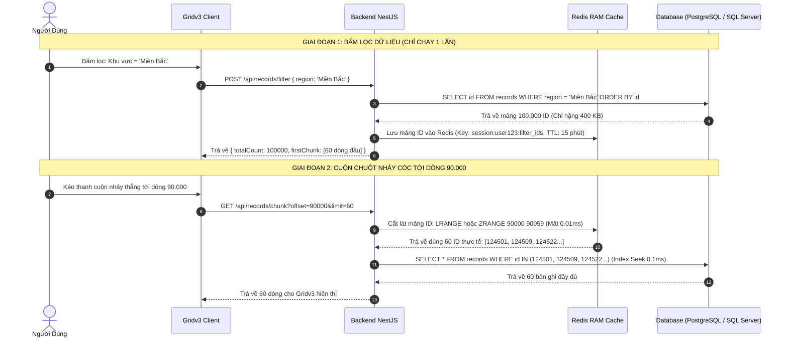

# Hai Kỹ Thuật Giải Quyết Bài Toán Deep Pagination & Hao Hụt Dòng Trong Ảo Hóa Dữ Liệu Lớn

> **Tài liệu kỹ thuật chuyên sâu**  
> **Dự án**: Gridv3 Virtualized Grid Engine  
> **Chủ đề**: Tối ưu hóa truy vấn dòng lớn (Offset Penalty) và chống hao hụt/lệch dòng khi xóa cứng, xóa mềm hoặc kéo thanh cuộn nhảy cóc (Random Access Scroll Jump).

---

## 1. Bản Chất Của Vấn Đề (The Problem)

Trong các hệ thống bảng dữ liệu doanh nghiệp (ERP, Tài chính, Báo cáo lớn), khi số lượng dòng vượt mốc 100.000 đến hàng triệu dòng, chúng ta gặp phải hai thách thức kỹ thuật đối lập nhau:

### Thách thức 1: Vấn đề "OFFSET Lớn" (The Deep Offset Penalty)
Khi người dùng cuộn xuống các dòng ở cuối bảng (ví dụ dòng thứ 90.000), câu lệnh SQL thông thường:
```sql
SELECT * FROM records 
ORDER BY id 
OFFSET 90000 ROWS FETCH NEXT 60 ROWS ONLY;
```
- **Hành vi ngầm của Database (SQL Server / PostgreSQL)**:
  1. Đọc và duyệt qua toàn bộ **90.000 dòng đầu tiên** từ ổ cứng vào bộ nhớ.
  2. Nạp toàn bộ dữ liệu của tất cả các cột của 90.000 dòng đó.
  3. Bỏ qua 90.000 dòng đó đi, rồi mới lấy tiếp 60 dòng tiếp theo.
- **Hậu quả**: Càng về cuối bảng, thời gian truy vấn càng tăng vọt (từ 5ms lên 1.500ms – 3.000ms), ngốn toàn bộ CPU và Disk I/O của máy chủ cơ sở dữ liệu.

### Thách thức 2: Tử huyệt của Keyset Pagination khi có "Xóa Dòng" và "Nhảy Cóc"
Nhiều tài liệu đề xuất dùng Keyset Pagination (`WHERE id > @last_id`), nhưng kỹ thuật này **bị phá sản hoàn toàn** trong bảng Grid doanh nghiệp vì 2 lý do:
1. **Bảng có Xóa Cứng (Hard Delete) hoặc Ẩn Dòng (Filter)**: Dãy ID không còn liên tục (bị thủng lỗ: mất ID 3, 7, 15...). Do đó, ID thứ 90.000 không hề tương đương với dòng thứ 90.000.
2. **Thao tác Kéo Thanh Cuộn Tự Do (Random Access Scroll Jump)**: Người dùng cầm chuột kéo thanh cuộn một phát từ đầu xuống vị trí 90% (dòng 90.000). Lúc này client **không hề có `last_id` của dòng 89.999** để làm mốc so sánh. Nếu đoán mò `id = 90000` thì sẽ bị **lệch dòng và hao hụt dữ liệu hoàn toàn**.

---

## 2. Kỹ Thuật 1: Kỹ Thuật "Deferred Join" (Chạy OFFSET Trên B-Tree Index Rỗng)

Áp dụng khi: Dữ liệu từ **100.000 đến 500.000 dòng**, truy vấn trực tiếp vào SQL Server hoặc PostgreSQL mà không dùng bộ nhớ đệm phụ.

### 2.1. Nguyên Lý Hoạt Động

Thay vì bắt Database phải đọc toàn bộ dữ liệu nặng của 20 cột cho 90.000 dòng, ta tách câu truy vấn thành **2 giai đoạn** bằng kỹ thuật **Deferred Join (Late Row Lookup qua Subquery)**:



### 2.2. Mã SQL Chi Tiết

#### Dành cho SQL Server:
```sql
SELECT t.*
FROM records t
INNER JOIN (
    -- Giai đoạn 1: Chỉ đọc trên Index (Covering Index)
    -- SQL Server thực hiện Index-Only Scan hoàn toàn trong RAM
    SELECT id 
    FROM records 
    WHERE is_deleted = 0 AND region = N'Miền Bắc'
    ORDER BY created_at ASC, id ASC
    OFFSET 90000 ROWS FETCH NEXT 60 ROWS ONLY
) sub ON t.id = sub.id
ORDER BY t.created_at ASC, t.id ASC;
```

#### Dành cho PostgreSQL:
```sql
SELECT t.*
FROM records t
INNER JOIN (
    SELECT id 
    FROM records 
    WHERE is_deleted = false AND region = 'Miền Bắc'
    ORDER BY created_at ASC, id ASC
    LIMIT 60 OFFSET 90000
) sub ON t.id = sub.id
ORDER BY t.created_at ASC, t.id ASC;
```

### 2.3. Vì Sao Kỹ Thuật Này Giải Quyết Triệt Để Cả 2 Thách Thức?
1. **Tuyệt đối không bị hao hụt hoặc lệch dòng**: Cơ sở dữ liệu tự động đếm chuẩn xác từng dòng thỏa mãn điều kiện lọc và bỏ qua các dòng đã xóa. Vị trí dòng thứ 90.000 là chính xác 100%.
2. **Nhanh gấp 50 – 100 lần so với OFFSET thông thường**: 
   - Thay vì nạp hàng trăm MB dữ liệu của 90.000 dòng vào bộ nhớ, Subquery chỉ quét trên B-Tree Index (chỉ tốn khoảng 4 bytes cho mỗi ID).
   - Toàn bộ B-Tree Index thường nằm sẵn trong RAM (Buffer Pool), Database không phải truy cập ổ đĩa (Disk I/O = 0). Thời gian truy vấn giảm từ **2.000ms xuống chỉ còn ~15ms – 30ms**.

---

## 3. Kỹ Thuật 2: Mảng ID Snapshot Trong RAM Redis (Chuẩn Mực Enterprise 2026)

Áp dụng khi: Dữ liệu từ **500.000 đến hàng triệu dòng**, bảng Grid có tần suất cuộn chuột cao và cần bảo vệ Database không bị quá tải.

### 3.1. Nguyên Lý Hoạt Động

Kỹ thuật này dựa trên một sự thật toán học: **ID dạng số nguyên (Integer) tốn cực kỳ ít bộ nhớ**:
- 1 số `int4` = 4 bytes.
- Mảng 100.000 ID = $100.000 \times 4 \text{ bytes} \approx 400 \text{ KB}$ (chỉ nặng **0.4 MB**, nhẹ hơn cả một bức ảnh web).
- Mảng 1.000.000 ID = **~4 MB RAM**.



### 3.2. Mã Nguồn Mẫu (Backend NestJS + Redis)

```typescript
// records.service.ts
@Injectable()
export class RecordsService {
  constructor(
    @InjectRedis() private readonly redis: Redis,
    private readonly db: DatabaseService,
  ) {}

  // 1. Khi người dùng áp dụng bộ lọc mới: Tạo Snapshot mảng ID vào Redis
  async applyFilter(sessionId: string, filterCondition: any) {
    // Chỉ truy vấn đúng 1 cột ID theo điều kiện lọc
    const ids: number[] = await this.db.query(
      `SELECT id FROM records WHERE region = $1 AND is_deleted = false ORDER BY id ASC`,
      [filterCondition.region]
    );

    const cacheKey = `grid:session:${sessionId}:ids`;
    // Lưu vào Redis dưới dạng List hoặc Sorted Set (mất 400KB RAM cho 100k phần tử)
    await this.redis.del(cacheKey);
    if (ids.length > 0) {
      await this.redis.rpush(cacheKey, ...ids.map(String));
      await this.redis.expire(cacheKey, 900); // Tự hủy sau 15 phút không dùng
    }

    // Lấy 60 dòng đầu tiên trả về cho client
    const firstIds = ids.slice(0, 60);
    const firstChunk = await this.fetchRecordsByIds(firstIds);

    return {
      totalCount: ids.length,
      data: firstChunk,
    };
  }

  // 2. Khi người dùng cuộn chuột nhảy cóc tới dòng 90.000
  async getChunkByOffset(sessionId: string, offset: number, limit: number) {
    const cacheKey = `grid:session:${sessionId}:ids`;
    
    // Cắt lát đúng 60 ID từ RAM của Redis (Độ phức tạp O(S+N), thời gian 0.01ms)
    const targetIds = await this.redis.lrange(cacheKey, offset, offset + limit - 1);
    
    if (!targetIds || targetIds.length === 0) {
      return [];
    }

    // Truy vấn Database bằng Primary Key B-Tree (Index Seek cực nhanh)
    return this.fetchRecordsByIds(targetIds.map(Number));
  }

  private async fetchRecordsByIds(ids: number[]) {
    return this.db.query(
      `SELECT * FROM records WHERE id = ANY($1::int[]) ORDER BY id ASC`,
      [ids]
    );
  }
}
```

### 3.3. Vì Sao Kỹ Thuật Này Là Chuẩn Mực Tối Thượng?
1. **Loại bỏ 100% rủi ro hao hụt dòng**: Vì mảng ID trong Redis được trích xuất từ câu lệnh lọc ban đầu, toàn bộ các dòng bị xóa cứng, xóa mềm hay không thỏa mãn điều kiện đều đã được loại bỏ. Vị trí phần tử thứ 90.000 trong mảng chính là dòng thứ 90.000 của người dùng.
2. **Database hoàn toàn rảnh rỗi**: Database không phải đếm lại, không phải quét qua 90.000 dòng. Thao tác cắt lát mảng diễn ra trong RAM của Redis với thời gian **< 0.1ms**.

---

## 4. Bảng So Sánh Tổng Hợp Các Phương Pháp

| Tiêu chí | OFFSET Thông Thường | Deferred Join (Kỹ Thuật 1) | Mảng ID Snapshot Redis (Kỹ Thuật 2) | Client-Side Gridv3 (Hiện Tại) |
| :--- | :--- | :--- | :--- | :--- |
| **Quy mô phù hợp** | < 10.000 dòng | 50.000 – 500.000 dòng | **500.000 – 10.000.000 dòng** | **50.000 – 100.000 dòng** |
| **Tốc độ ở dòng 90.000** | Rất chậm (1.000 – 3.000ms) | Nhanh (15 – 30ms) | **Siêu tốc (< 5ms)** | **Tức thì (0ms trong RAM)** |
| **Độ chính xác khi xóa dòng** | Chính xác | **Chính xác tuyệt đối** | **Chính xác tuyệt đối** | **Chính xác tuyệt đối** |
| **Tải trên Database** | Rất nặng (Quét toàn bộ cột) | Trung bình (Quét B-Tree Index) | **Cực nhẹ (Database chỉ Seek 60 ID)** | **0% tải (Không gọi lại DB)** |
| **Độ phức tạp hạ tầng** | Đơn giản nhất | Đơn giản (Chỉ sửa câu lệnh SQL) | Cần có Redis Cache | Không cần cấu hình thêm |

---

## 5. Lời Khuyên Thực Chiến Dành Cho Bạn

1. **Với hệ thống hiện tại của bạn (Quy mô 50.000 – 100.000 dòng)**:
   - **Giữ nguyên cơ chế Client-Side Chunk Virtualization hiện tại của Gridv3**:
     - Toàn bộ 50k dòng nén gzip tải về chỉ mất **~2.5 MB** (tải 1 lần duy nhất mất **0.2s**).
     - Toàn bộ việc lọc, gõ phím, cuộn chuột, gom nhóm diễn ra trong RAM trình duyệt với tốc độ **0ms tuyệt đối**.
     - Server không phải chịu tải khi người dùng cuộn chuột, không lo rủi ro lệch ID.
2. **Khi dữ liệu công ty mở rộng vượt ngưỡng 500.000 dòng**:
   - Áp dụng ngay **Kỹ Thuật 2 (Mảng ID Snapshot trong Redis)**: Đây là giải pháp hoàn hảo nhất vừa giải quyết bài toán nhảy cóc vừa triệt tiêu lỗi hao hụt dòng.
